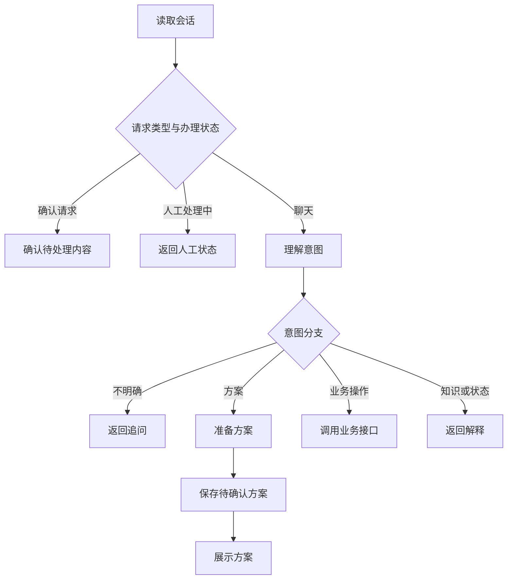

# LangGraph 流程迁移更新

适用于已安装多轮对话更新包、并通过 run_multiturn_live.py 的 car_insurance_ai 项目。Python 3.11+。本次本地使用 Python 3.12 和 langgraph 1.2.20 测试。

## 文件放置

先停止服务，备份 app/main.py。按下表复制文件。

| 更新包文件 | 项目内的位置 | 操作 |
|---|---|---|
| app/main.py | app/main.py | 替换 |
| app/agent_graph.py | app/agent_graph.py | 新增 |
| requirements-langgraph.txt | 项目根目录 | 新增 |
| tests/test_langgraph.py | tests/test_langgraph.py | 新增 |
| LANGGRAPH_UPDATE.md | 项目根目录 | 放入并阅读 |

本包依赖已有 models.py、providers.py、business.py、knowledge.py 和 rag.py。继续使用上一版已测试成功的模型配置。MODE=demo，业务和 OCR 仍使用模拟数据。

## 安装与启动

在项目根目录 PowerShell 执行安装命令。requirements-langgraph.txt 引用原 requirements.txt，并安装已验证版本的 LangGraph。

```powershell
cd C:\Users\woshi\Desktop\car_insurance_ai
.\.venv\Scripts\python.exe -m pip install -r requirements-langgraph.txt
```

然后运行本地回归测试。测试使用模拟模型，不消耗真实模型额度。

```powershell
.\.venv\Scripts\python.exe -m unittest discover -s tests -p "test_*.py" -v
```

包含上一版 test_multiturn.py 时，本次相关测试共 17 项。如果原 tests 还有其他测试，数量可能更多。

启动服务。

```powershell
.\.venv\Scripts\python.exe -m uvicorn app.main:app --reload --host 127.0.0.1 --port 8000
```

打开 http://127.0.0.1:8000/health，应看到 engine 为 langgraph。再打开另一个 PowerShell，进入项目根目录运行已有真实模型测试。

```powershell
.\.venv\Scripts\python.exe run_multiturn_live.py
```

这个脚本会调用你配置的 DeepSeek，消耗模型 API 额度，验证 200万 → 300万 → 追问 → 取消车损 → 确认保存。

## 实际改了什么

FastAPI 的聊天和确认接口现在调用 agent_graph.ainvoke。LangGraph 使用 StateGraph 定义业务状态、节点和条件边，然后 compile 为可执行图。

原有流程拆分为 13 个节点。

| 节点 | 职责 |
|---|---|
| load_record | 从业务接口读取当前会话并验证访问权限 |
| human_paused | 返回人工接管状态 |
| understand_intent | 调用已有模型和多轮提示词 |
| ask_clarification | 返回追问，保持当前方案 |
| prepare_plan | 获取推荐/历史方案，或合并修改字段 |
| stage_plan | 保存待确认方案，获取确认 token |
| describe_plan | 根据业务接口结果生成方案摘要 |
| request_confirmation | 提示用户通过确认接口提交 token |
| confirm_pending | 校验并提交方案或材料的确认 token |
| execute_business | 调用报价、核保、支付、出单、取消或人工接管接口 |
| submit_underwriting | 报价完成后衔接核保 |
| describe_business | 根据业务状态返回用户提示 |
| answer_help | 检索术语并解释 |

主要分支示意如下。



如需展示代码实际生成的完整图，可以执行以下命令输出 Mermaid 文本。

```powershell
.\.venv\Scripts\python.exe -c "from app.agent_graph import agent_graph; print(agent_graph.get_graph().draw_mermaid())"
```

## 状态和暂停方式

AgentState 包含本次消息、用户身份、会话 ID、最近六轮历史、最新业务记录、提取意图、待生成方案和最终回复。它在图节点之间传递。

本版以一次 HTTP 请求运行一次图。遇到追问或待确认时返回结果并结束本次执行。用户下一条消息或确认请求会携带上下文再次进入图。

跨请求历史仍保存在有界的进程内存中，最近六轮、闲置 30 分钟过期、最多 512 会话。业务状态每次从业务后端读取，demo 模式下业务后端同样位于内存。重启会清空，开发时只使用一个服务进程。

LangGraph 的 checkpoint 持久化和 interrupt/resume 尚未接入。本次完成实际节点编排迁移，恢复执行与共享存储属于后续与成员 B 对接的工作。确认令牌仍由业务层校验，模型不能直接批准确认。

文件上传和 OCR 仍走已有 FastAPI 材料入口。后续确认 OCR 契约后，再将识别与补件过程纳入相应图节点。

## 验证结果

本地已通过原 tests/smoke.py 的模拟全流程、10 项多轮回归和 7 项 LangGraph 路由测试。路由测试通过 astream 的节点更新检查实际执行路径，覆盖方案生成、追问、令牌确认、人工暂停、报价后核保、报价失败阻断和并行会话隔离。

本次本地未调用你的真实 DeepSeek 账号，也未与成员 B 的真实业务接口联调。修改后请在本机执行 run_multiturn_live.py。

当前旧版模拟业务接口的 version 仍用于会话记录，正式方案版本、幂等规则和持久化按成员 B 的最终契约对齐。本次更新没有把模拟数据变成真实保险数据。

## 回退

停止服务后，把备份的 app/main.py 放回原处，再启动即可回到此前流程。已安装的 LangGraph 包可以留在虚拟环境中。

## 实现参考

- [LangGraph Graph API](https://docs.langchain.com/oss/python/langgraph/graph-api)
- [LangGraph Persistence](https://docs.langchain.com/oss/python/langgraph/persistence)
