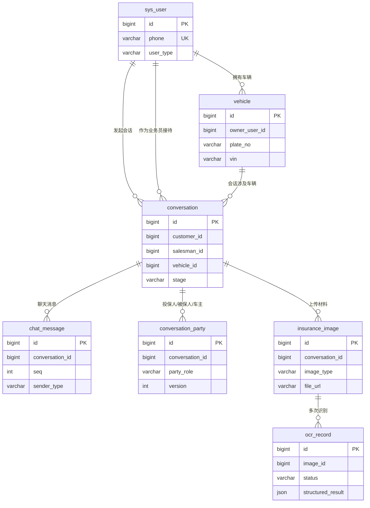
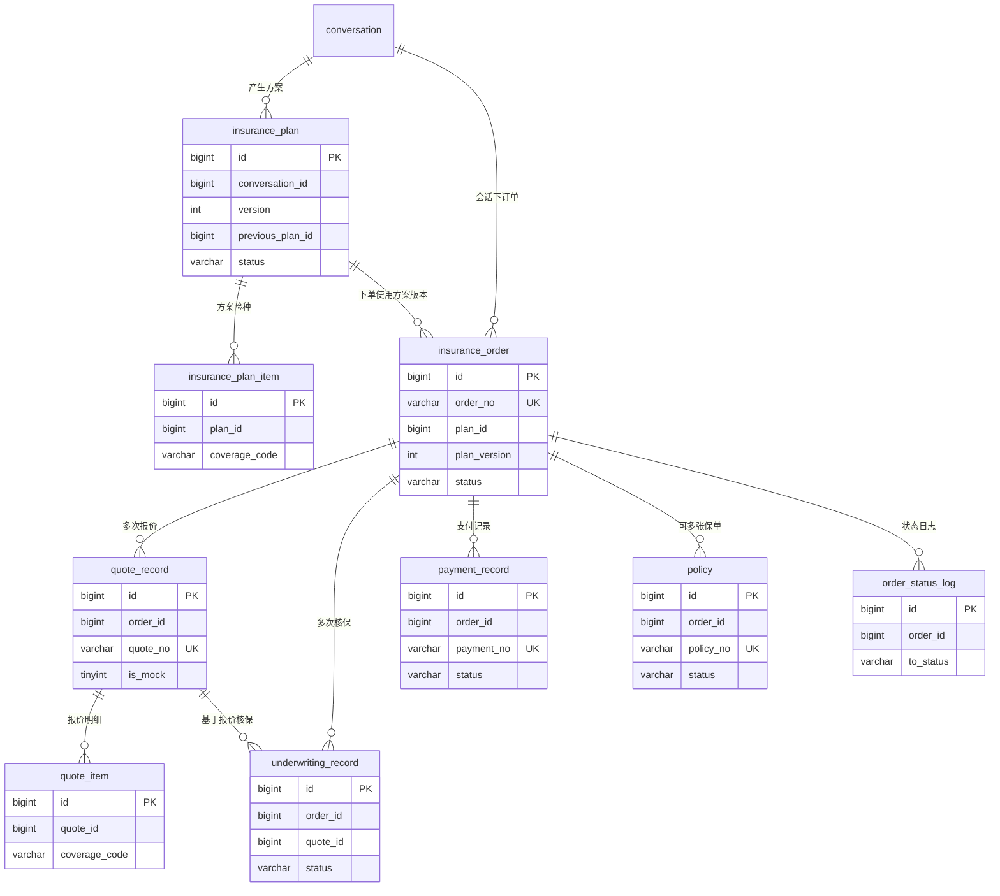
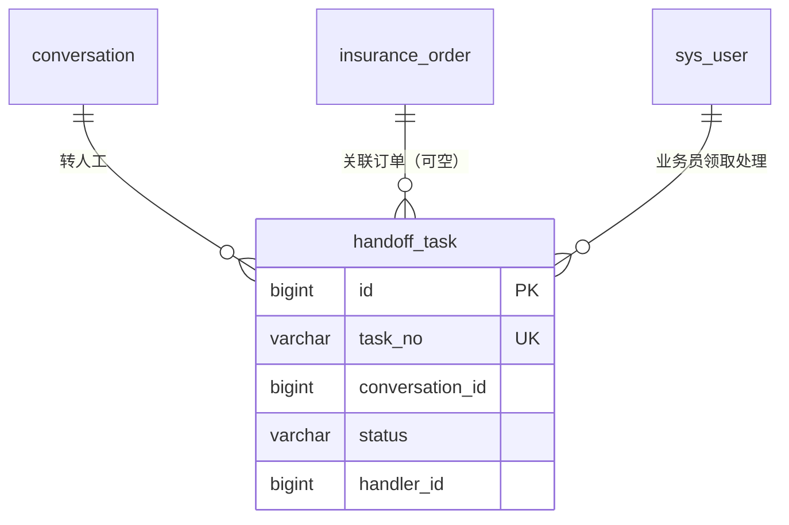

# 数据库关系说明（第一版 17 张表）

> 配套：`backend/src/main/resources/sql/init.sql`、`docs/数据库设计.md`
>
> 本项目不建物理外键（只建索引），下图中"一对多"由 Java Service 层保证。

## 1. 用户、车辆、会话、消息与材料

## 2. 方案、订单、报价、核保、支付与保单

## 3. 人工转接

## 4. 关系清单

| 关系 | 基数 | 关联字段 | 说明 |
| --- | --- | --- | --- |
| 用户 → 车辆 | 1 : N | `vehicle.owner_user_id` | 一个车主多辆车 |
| 用户 → 会话 | 1 : N | `conversation.customer_id` | 客户发起多次会话 |
| 用户 → 会话 | 1 : N | `conversation.salesman_id` | 业务员可接待多个会话 |
| 车辆 → 会话 | 1 : N | `conversation.vehicle_id` | 同一辆车可多次投保 |
| 会话 → 消息 | 1 : N | `chat_message.conversation_id` | `seq` 保证顺序 |
| 会话 → 人员 | 1 : N | `conversation_party.conversation_id` | 三种角色，多版本 |
| 会话 → 材料 | 1 : N | `insurance_image.conversation_id` | 行驶证、身份证等 |
| 材料 → OCR | 1 : N | `ocr_record.image_id` | 同一文件多次识别 |
| 会话 → 方案 | 1 : N | `insurance_plan.conversation_id` | 每次修改生成新版本 |
| 方案 → 明细 | 1 : N | `insurance_plan_item.plan_id` | 每个险种一行 |
| 会话 → 订单 | 1 : N | `insurance_order.conversation_id` | 一个会话可下多单 |
| 方案 → 订单 | 1 : N | `insurance_order.plan_id` + `plan_version` | 订单锁定方案版本 |
| 订单 → 报价 | 1 : N | `quote_record.order_id` | 允许多次报价 |
| 报价 → 明细 | 1 : N | `quote_item.quote_id` | 每险种一行 |
| 订单 → 核保 | 1 : N | `underwriting_record.order_id` | 允许多轮核保 |
| 报价 → 核保 | 1 : N | `underwriting_record.quote_id` | 核保基于某次报价 |
| 订单 → 支付 | 1 : N | `payment_record.order_id` | 多次支付尝试 |
| 订单 → 保单 | 1 : N | `policy.order_id` | 交强险/商业险可分开出单 |
| 订单 → 状态日志 | 1 : N | `order_status_log.order_id` | 只追加 |
| 会话 → 转人工 | 1 : N | `handoff_task.conversation_id` | 可多次转人工 |

## 5. 订单为什么要保存快照

`insurance_order` 里有 `vehicle_snapshot`、`party_snapshot`、`plan_snapshot` 三份 JSON，
再加 `plan_version`：

- 下单那一刻的车辆、人员、方案内容被"冻结"；
- 之后用户修改车辆资料或新建方案版本，**不会改变历史订单**；
- 出现纠纷时，以快照为准，而不是以当前最新数据为准。

这也是不建立 `vehicle_id → 订单` 强依赖最新记录的原因。
