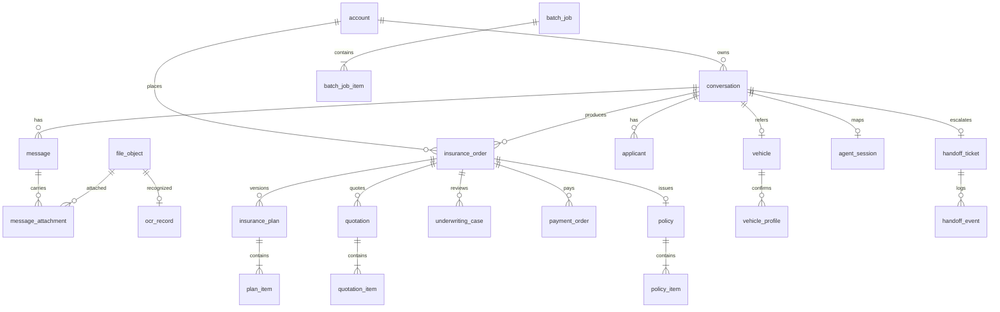

# 数据库设计总结（面向前端功能）

> 回答一个问题：**前端这些页面和交互，背后到底需要什么样的数据库？**
>
> 参考 DDL：`docs/schema/mysql-schema.sql`（27 张表，已做语法解析校验，未在真实实例执行）。
> 数据库选型：**MySQL 8**（成员 B 负责建库与接口），Agent 侧（成员 C）的 LangGraph checkpoint
> 与向量库独立部署，只通过 `conversation_id` 关联。
> **状态：设计草案，未经后端确认。**

---

## 0. 先说边界

- 《前端.md》写明：前端**不访问、不修改数据库**，所有业务数据通过成员 B 的 API 获取。
  所以本文不是"前端要建库"，而是**前端每个交互需要哪些字段、这些字段从哪张表来**，
  用来和 B 对齐接口，避免"接口返回了但页面凑不出"。
- 前端里所有 `id` 都是 `string`（`types/index.ts`），后端返回 ULID 或字符串化的数字都行，
  只要**同一资源在列表和详情里 id 一致**。
- 本文用「表」来讨论，实际接口可以聚合多表返回一个 DTO，前端不关心 join。

---

## 1. 设计原则（8 条，决定了后面的表结构）

| # | 原则 | 为什么（对应前端哪一段） |
| --- | --- | --- |
| 1 | **会话是聊天容器，投保单（order）是业务单据，两者分离** | 一个会话可能因为报价过期重报多次；`/chat` 展示会话，`/orders` 展示单据 |
| 2 | **一个会话一个车牌；出现新号牌就新建会话** | 需求明确"会话标题取车牌号，第二个车牌自动开新会话" |
| 3 | **方案追加不修改（版本化）** | 方案卡片要显示"服务端确认后的版本"，改一次就 `v1 → v2` |
| 4 | **报价 / 核保 / 支付 / 保单都是快照** | 改方案不能把已经报出去的金额滚掉，否则支付金额对不上 |
| 5 | **文件元数据与业务解耦** | 行驶证、身份证、验车视频都用同一个 `file_object`，用 `category` 区分 |
| 6 | **OCR 原始结果与用户确认结果分开存** | 需求要求"不把 OCR 结果默认视为最终正确"，要能追溯改了什么 |
| 7 | **身份证号密文 + 哈希 + 脱敏三列** | 需求要求"页面不暴露不必要的完整证件号" |
| 8 | **所有状态用字符串 + 流转时间戳** | 前端只渲染状态，不推断；加状态不用改表 |

---

## 2. 关系总览

```
account ─┬─< conversation ─┬─< message ──< message_attachment ──> file_object
         │                 │                                        │
         │                 ├─< insurance_order ─┬─< insurance_plan ─< plan_item
         │                 │                    ├─< quotation ─< quotation_item
         │                 │                    ├─< underwriting_case ─< underwriting_material
         │                 │                    ├─< payment_order
         │                 │                    └─── policy ─< policy_item
         │                 ├─< applicant（身份证，1~2 条：投保人/被保人）
         │                 ├─── vehicle ──< vehicle_profile
         │                 ├─< handoff_ticket ─< handoff_event
         │                 └─── agent_session（↔ C 的 LangGraph thread）
         ├─< batch_job ─< batch_job_item
         └──  vehicle / quotation / payment / policy 之间的引用都在 order 上收敛
```

核心 15 个实体的 ER：



---

## 3. 表清单（27 张，按域分组）

### 3.1 身份与权限（1 张）

| 表 | 用途 | 关键字段 | 前端对应 |
| --- | --- | --- | --- |
| `account` | 普通用户与业务员共存，`role` 区分；普通用户通过 `parent_agent_id` 绑定业务员（需求：登录自带业务员 ID） | `username`、`password_hash`、`role`、`agent_no`、`parent_agent_id`、`status` | 登录页、路由守卫、菜单裁剪、侧边栏身份卡 |

> 业务员不是单独的表：工号/机构字段放在 `account` 上，`role='AGENT'`。这样订单里只需
> `agent_account_id` 一个外键，不用两套用户体系。

### 3.2 车辆（2 张）

| 表 | 用途 | 关键字段 | 前端对应 |
| --- | --- | --- | --- |
| `vehicle` | 车辆主数据；`plate_norm` 是归一化车牌（去点/空格）用于查询 | `plate_number`、`plate_norm`、`vin`、`engine_no`、`owner_name`、`register_date`、`usage_nature` | 右侧栏「车辆资料」、保单页车辆信息 |
| `vehicle_profile` | 用户**确认后**的资料快照 + 修正字段留痕 | `fields_json`、`corrected_fields`、`source`、`ocr_record_id`、`confirmed_at` | 「OCR 结果确认」→ 确认按钮 |

> 为什么不直接改 `vehicle`：OCR 结果可能错，用户可能改；`vehicle` 存"当前可信值"，
> `vehicle_profile` 存"这次确认的依据"，出纠纷时能查是谁在什么时候改的什么。

### 3.3 会话与消息（3 张）

| 表 | 用途 | 关键字段 | 前端对应 |
| --- | --- | --- | --- |
| `conversation` | 会话，标题即车牌号；`stage` 对应七个阶段 | `conv_no`、`account_id`、`agent_account_id`、`plate_number`、`stage`、`status`、`last_message_at` | 侧边栏会话列表、聊天页头 |
| `message` | 消息；`role`/`message_type` 与前端契约一致 | `msg_no`、`sender_type`、`role`、`message_type`、`content`、`payload_json`、`client_msg_id` | 聊天气泡、方案卡片、状态卡片、转人工卡片 |
| `message_attachment` | 消息 ↔ 文件，一条消息可带多图 | `message_id`、`file_id`、`category`、`sort_no` | 图片消息 |

> `client_msg_id` 是**前端幂等键**：网络重试不会产生两条一样的用户消息。
> 分页用 `(conversation_id, id)` 游标，不要 `OFFSET` 深翻页。

### 3.4 影像与 OCR（2 张）

| 表 | 用途 | 关键字段 | 前端对应 |
| --- | --- | --- | --- |
| `file_object` | 文件元数据，**不存二进制**（放对象存储） | `file_no`（=接口里的 `fileId`）、`category`、`object_key`、`mime_type`、`size_bytes`、`sha256`、`status` | 行驶证正/副页、身份证正/反面、验车照片视频、聊天图片 |
| `ocr_record` | 每次 OCR 的原始与归一化结果 | `file_id`、`ocr_type`、`provider`、`fields_json`、`raw_json`、`confidence_avg`、`status` | 「OCR 结果确认」的异常高亮、置信度 |

> `sha256` 用于秒传/去重；`raw_json` 保留供应商原文，换 OCR 服务商时能回溯对比。

### 3.5 身份资料（1 张）

| 表 | 用途 | 关键字段 | 前端对应 |
| --- | --- | --- | --- |
| `applicant` | 投保人 / 被保人（`role_type` 区分） | `name`、`id_type`、`id_no_enc`、`id_no_hash`、`id_masked`、`valid_to`、`confirmed_at` | 身份证影像确认、保单页投保人/被保人 |

> 前端只拿 `id_masked`；`id_no_enc` 是 AES-256-GCM 密文，`id_no_hash` 用于查重。
> 明文永远不出服务端。

### 3.6 投保单主链（9 张）

| 表 | 用途 | 关键字段 | 前端对应 |
| --- | --- | --- | --- |
| `insurance_order` | **聚合根**：把方案/报价/核保/支付/保单串起来 | `order_no`、`conversation_id`、`account_id`、`agent_account_id`、`status`、`total_premium`、`plan_id`/`quotation_id`/`payment_id`/`policy_id` | `/orders`、业务员工作台、批量操作 |
| `insurance_plan` | 方案，**只追加不修改**，`version` 自增 | `version`、`parent_plan_id`、`company_code`、`total_premium`、`status`、`instruction`、`changed_json` | 方案卡片「推荐方案 · v1」、改方案的版本号 |
| `plan_item` | 方案险种明细 | `coverage_code`、`coverage_name`、`coverage_amount`、`premium`、`is_required` | 方案卡片表格 |
| `quotation` | 报价单（快照） | `quotation_no`、`plan_id`、`status`、`total_premium`、`valid_until`、`fail_reason` | 报价状态、有效期倒计时 |
| `quotation_item` | 报价明细快照 | 同上字段 | 报价明细 |
| `underwriting_case` | 核保案件 | `status`（PENDING/PASS/REJECT/NEED_MATERIAL）、`reason`、`required_materials` | 核保通过/失败/补材料入口 |
| `underwriting_material` | 验车照片/视频 | `case_id`、`file_id`、`material_type` | 补充验车材料 |
| `payment_order` | 支付单 | `out_trade_no`、`transaction_id`、`amount`、`status`、`pay_url`、`paid_at` | 支付跳转、支付状态 |
| `policy` + `policy_item` | 保单与险种花费快照 | `policy_no`、`effective_from/to`、`terms_json`、各险种 `premium` | 保单明细页 |

> 为什么方案要版本化、报价要快照：用户说"把三者提到 200 万"→ 新方案 `v2`；但 `v1` 可能
> 已经报过价、核过保。如果把 `quotation` 挂在一个可变的 `plan` 上，历史金额就被篡改了。

### 3.7 业务员批量（2 张）

| 表 | 用途 | 关键字段 | 前端对应 |
| --- | --- | --- | --- |
| `batch_job` | 一次批量操作 | `job_no`、`agent_account_id`、`action`、`total/success/fail_count`、`status` | 批量按钮的结果汇总 |
| `batch_job_item` | 逐条结果 | `order_id`、`status`、`error_msg` | 「批量操作有结果反馈」的明细 |

> 只有汇总没有明细，前端只能显示"成功 8 条"，说不出是哪 2 条失败、为什么——
> 验收标准里"批量操作有结果反馈"过不了。

### 3.8 人工接管（2 张）

| 表 | 用途 | 关键字段 | 前端对应 |
| --- | --- | --- | --- |
| `handoff_ticket` | 转人工工单 | `ticket_no`、`status`、`reason`、`queue_position`、`assigned_agent_id` | 转人工状态、排队位次 |
| `handoff_event` | 事件流 | `event_type`、`payload_json`、`actor_type`、`created_at` | 人工接管页时间线 |

### 3.9 知识库与 Agent 映射（2 张）

| 表 | 用途 | 关键字段 | 前端对应 |
| --- | --- | --- | --- |
| `kb_term` | 行业术语（"三者"↔"第三者责任险"） | `term`、`normalized`、`definition`、`synonyms` | 术语解释、Agent 对齐口语 |
| `agent_session` | `conversation_id` ↔ LangGraph `thread_id` | `thread_id`、`graph_version`、`last_checkpoint_id` | 前端无感，纯后端/Agent 衔接 |

### 3.10 通用（2 张，前端不直连）

| 表 | 用途 |
| --- | --- |
| `audit_log` | 登录、报价、支付回调等关键动作审计；**不得写入身份证号原文** |
| `idempotency_key` | 报价/支付/上传重试的幂等（键 + 请求指纹 + 结果回放） |

---

## 4. 六个状态机（前端按这个渲染，不自己猜）

**会话阶段** `conversation.stage`

```
COLLECTING → RECOMMENDED → IDENTITY → QUOTED → UNDERWRITING → PAYING → ISSUED
      └────────────── 任意阶段 → ABORTED（用户放弃/换车牌）──────────────┘
```

**投保单** `insurance_order.status`（聚合状态，跟随子流程推进）

```
COLLECTING → RECOMMENDING → IDENTITY → QUOTED → UNDERWRITING → PAY_PENDING → ISSUED
                                   └→ FAILED（核保拒绝/支付失败）→ 可重新发起
```

**方案** `insurance_plan.status`：`PROPOSED → CONFIRMED`，被新版替代则 `SUPERSEDED`。

**报价** `quotation.status`：`QUOTING → QUOTED → (EXPIRED)`，失败 `FAILED`。

**核保** `underwriting_case.status`：`PENDING → PASS | REJECT | NEED_MATERIAL`；
`NEED_MATERIAL` 补完材料回到 `PENDING`。

**支付** `payment_order.status`：`CREATED → PENDING → SUCCESS | FAILED | CLOSED`，
退款追加 `REFUNDED`。**只有 `SUCCESS` 才允许生成保单**。

**接管** `handoff_ticket.status`：`REQUESTED → QUEUED → SERVING → CLOSED`，可 `CANCELLED`。

---

## 5. 前端页面 ↔ 表 ↔ 接口

| 页面 / 组件 | 主要表 | 建议接口（一次拿够，别让前端拼） |
| --- | --- | --- |
| 登录页 | `account` | `POST /api/auth/login` |
| 侧边栏会话列表 | `conversation` | `GET /api/conversations` |
| 聊天页（消息流） | `message`、`message_attachment`、`file_object` | `GET /api/conversations/{conversationId}/messages` |
| 聊天页（发消息） | `message`、`agent_session` | `POST /api/conversations/{conversationId}/messages` |
| 车辆资料 + OCR 确认 | `file_object`、`ocr_record`、`vehicle`、`vehicle_profile` | `POST /api/files`、`POST /api/ocr/license`、`POST .../vehicle-profile/confirm` |
| 身份证影像 | `file_object`、`ocr_record`、`applicant` | `POST /api/files`、`POST /api/ocr/idcard`、`POST .../applicant/confirm` |
| 方案卡片 | `insurance_plan`、`plan_item` | `POST /api/plans/recommend`、`POST /api/plans/{planId}/revise` |
| 报价区块 | `quotation`、`quotation_item` | `POST /api/quotations`、`GET /api/quotations/{quotationId}` |
| 核保区块 | `underwriting_case`、`underwriting_material` | `POST /api/underwritings`、`POST .../materials` |
| 支付区块 | `payment_order` | `POST /api/payments`、`GET /api/payments/{paymentId}` |
| 保单页 | `policy`、`policy_item`、`applicant`、`vehicle` | `GET /api/policies/{policyId}` |
| 订单页 | `insurance_order` | `GET /api/orders`（不要返回 4 个子对象让前端合并） |
| 业务员工作台 | `insurance_order`、`batch_job`、`batch_job_item` | `GET /api/workbench/orders`、`POST /api/workbench/batches` |
| 人工接管页 | `handoff_ticket`、`handoff_event`、`message` | `GET /api/handoffs/{ticketId}` |
| 术语知识库 | `kb_term` | `GET /api/knowledge/terms?q=` |

**给 B 的一条要求**：列表页（会话、订单、工作台）请返回**已聚合好的 DTO**，
包含车牌号、状态、金额、最后更新时间；不要让前端拿到 id 再串行请求 4 个接口。

---

## 6. 索引与查询（直接影响前端首屏）

| 场景 | 查询 | 依赖索引 |
| --- | --- | --- |
| 会话列表 | `WHERE account_id=? AND status='ACTIVE' ORDER BY updated_at DESC` | `conversation(account_id, status, updated_at)` |
| 消息游标 | `WHERE conversation_id=? AND id < ? ORDER BY id DESC LIMIT 30` | `message(conversation_id, id)` |
| 订单列表 | `WHERE account_id=? ORDER BY updated_at DESC` | `insurance_order(account_id, status, updated_at)` |
| 工作台漏斗 | `WHERE agent_account_id=? AND status=? ORDER BY updated_at DESC` | `insurance_order(agent_account_id, status, updated_at)` |
| 车牌续保查询 | `WHERE plate_norm=?` / `WHERE vin=?` | `vehicle(plate_norm)`、`vehicle(vin)` |
| 保单查重 | 按车 + 有效期区间 | `policy(vehicle_id)`、`policy(effective_to)` |
| 审计检索 | 按人/资源 + 时间 | `audit_log(account_id, created_at)` |

**分页**：一律游标（`id` 或 `updated_at + id`），不要 `OFFSET`——消息表一年后深翻页会明显变慢。

---

## 7. 数据量与归档（估算，便于 B 选规格）

按 **10 万单/年** 粗估：

| 表 | 年增量 | 备注 |
| --- | --- | --- |
| `message` | ~400 万行（每单约 40 条） | 4–6 GB，最大的一张 |
| `file_object` | ~100 万行（每单 4–8 张图） | 图片本体在对象存储，约 2 TB/年 |
| `insurance_order` / `quotation` / `payment_order` / `policy` | 各 ~10–30 万行 | 都很轻 |
| `audit_log` | 千万级 | 建议按月分区或归档到低成本存储 |

**分区注意**：MySQL 要求分区键出现在每个唯一键里。`message` 若有
`UNIQUE(conversation_id, client_msg_id)` 就不能直接按 `created_at` 分区。
两个选择：① 不分区，按 `conversation_id` 归档冷表；② 唯一键改成
`(conversation_id, client_msg_id, created_at)` 后再按月分区。**建议先选①**，简单可控。

---

## 8. 敏感数据与合规

| 数据 | 处理 |
| --- | --- |
| 身份证号 | `id_no_enc`（AES-256-GCM）+ `id_no_hash`（加盐 SHA-256）+ `id_masked`；密钥放 KMS/环境变量，支持轮换 |
| 证件影像 | 只存对象存储 key；访问一律后端签发**短期签名 URL（5–10 分钟）**，不要公开 bucket |
| 手机号 | 展示脱敏（138****1234），落库可明文但接口默认脱敏 |
| 日志 | `audit_log.detail_json` 禁止写证件号、支付卡号原文 |
| 保留期 | 建议：保单/合同类按监管要求（≥10 年）、影像 1 年、聊天 2 年 → **需法务确认后固化** |

---

## 9. 与 Agent（成员 C）的边界

| 事项 | 归属 | 说明 |
| --- | --- | --- |
| 用户消息 / AI 消息落库 | **B** | 单一写入方，保证顺序与审计；C 不直接写业务库 |
| LangGraph checkpoint、对话记忆 | **C** | 独立存储（Postgres/Redis/文件），不进业务库 |
| `conversation_id ↔ thread_id` | **B** 维护 `agent_session` | C 返回 thread_id，B 落库 |
| 方案结构化 | **B** 存 `insurance_plan` + `plan_item` | 不要只存 LLM 的 JSON blob，否则报价/核保拿不到稳定字段 |
| 知识库术语 | **B** 存 `kb_term` | RAG 向量在 C 侧，用 `term_id` 关联，避免两边各存一份定义 |
| OCR | **C** 提供识别接口 | 原始结果落 `ocr_record`（B 写），确认值落 `vehicle_profile`/`applicant` |

---

## 10. 最小表集（按阶段建，不用等 27 张全齐）

| 波次 | 表 | 能跑通什么 |
| --- | --- | --- |
| 一（9 张） | `account`、`conversation`、`message`、`file_object`、`ocr_record`、`vehicle`、`vehicle_profile`、`insurance_plan`、`plan_item` | 登录 → 上传 → OCR → 确认 → 方案推荐/修改（C 已自测的能力） |
| 二（8 张） | `insurance_order`、`applicant`、`quotation`、`quotation_item`、`underwriting_case`、`underwriting_material`、`payment_order`、`policy`、`policy_item` | 报价 → 核保 → 支付 → 保单 |
| 三（10 张） | `batch_job`、`batch_job_item`、`handoff_ticket`、`handoff_event`、`kb_term`、`agent_session`、`message_attachment`、`audit_log`、`idempotency_key` | 业务员批量、人工接管、术语库、审计与幂等 |

---

## 11. 待确认问题（给成员 B）

| # | 问题 | 我的建议 |
| --- | --- | --- |
| 1 | 是否引入 `insurance_order` 作为聚合根？ | **引入**。否则 `/orders` 要前端拼 4 张表，批量操作也无从下手 |
| 2 | 会话与投保单是 1:1 还是 1:N？ | **1:N**（报价过期要重报；一个会话多次投保） |
| 3 | 方案历史是否全留？ | **全留**（append-only + parent 链），前端只取 `CONFIRMED` 的最新版 |
| 4 | 同一方案能否多次报价？ | 允许，取最新未过期的 `QUOTED` |
| 5 | 支付是否只允许一笔成功？ | 是，`out_trade_no` 唯一 + 回调幂等 |
| 6 | 保单号由谁生成？ | 保险公司回传，B 落库；我方只加内部 `id` |
| 7 | 业务员可见范围？ | 按 `agent_account_id` 过滤；跨机构需额外授权表 |
| 8 | 对象存储选型？ | OSS/COS 任一，私有读 + 签名 URL；本地开发用 `LOCAL` 也行 |
| 9 | 身份证保留期与密钥管理？ | 待法务；密钥必须可轮换 |
| 10 | 是否需要多租户（机构隔离）？ | 若要多机构，`account` 加 `tenant_id`，全表带租户过滤 |

---

## 12. 前端需要跟着改的三处（等接口定了我再动）

1. `/orders` 若采用 `insurance_order` 聚合返回，`WorkbenchRow` 的 `orderId` 直接用 `order_no`。
2. 方案卡片增加"改了什么"：接 `insurance_plan.changed_json`，在气泡里补一行说明。
3. 确认动作改为显式 `POST .../confirm`，前端提交 `corrected_fields`，并在失败时回填
   `missingFields` 高亮。
