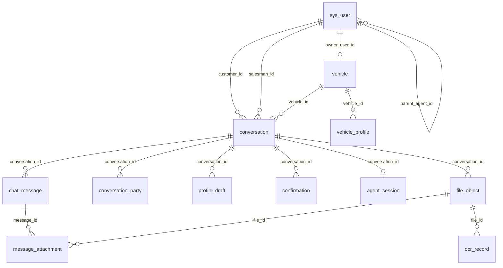
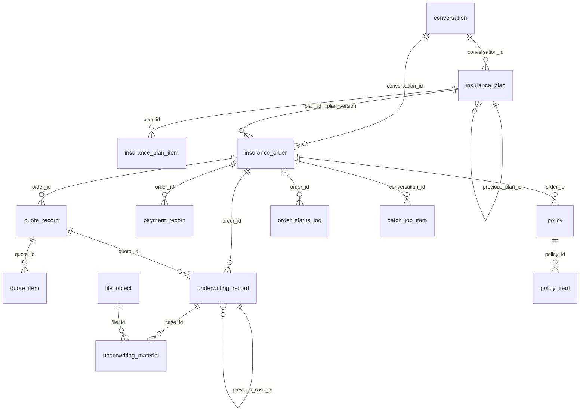
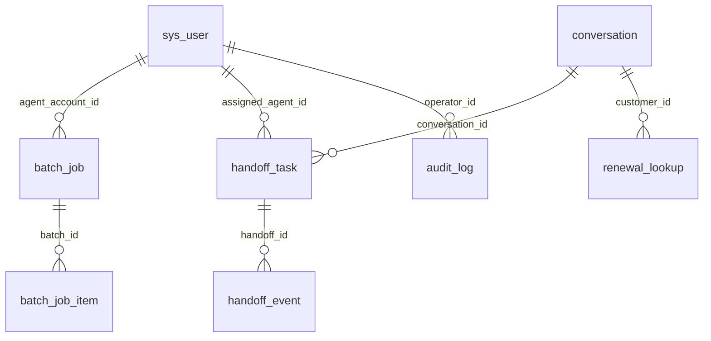

# 数据库关系说明（v2 · 31 张表）

> 配套：[init.sql](../backend/src/main/resources/sql/init.sql)、[数据库设计.md](数据库设计.md)
> 说明：所有关系都是**逻辑外键**（只建索引，不建 FOREIGN KEY），删除父表数据不会级联删除订单/保单。

## 1. 身份、车辆与会话

要点：

- 一个客户（`CUSTOMER`）有多辆车、多个会话；业务员通过 `salesman_id` 参与会话。
- `parent_agent_id` 让客户绑定归属业务员，第一版不建独立授权表。
- 同一车牌可以多次办理，因此 `conversation` 不是按车牌唯一。
- 同一文件可以多次 OCR，`ocr_record` 用 `(file_id, recognition_request_id)` 去重。

## 2. 方案 → 订单 → 报价 → 核保 → 支付 → 保单

要点：

- 一个会话可以产生多张订单；方案每次修改新增版本，订单锁定 `plan_id + plan_version`。
- 一单可多次报价、多次核保、多次支付尝试；通过订单上的 `active_quote_id` / `active_underwriting_id` / `active_payment_id` 指向当前有效记录。
- 一单可出多张保单（交强险、商业险分别出单），`policy_type` 区分。
- 核保补件重提用 `previous_case_id` 串成案件链。

## 3. 运营与系统保障

## 4. 关系清单

| 父表 | 子表 | 基数 | 关联字段 |
|---|---|---|---|
| `sys_user` | `vehicle` | 1:N | `owner_user_id` |
| `sys_user` | `conversation` | 1:N | `customer_id` / `salesman_id` |
| `sys_user` | `sys_user` | 1:N | `parent_agent_id` |
| `vehicle` | `conversation` | 1:N | `vehicle_id` |
| `vehicle` | `vehicle_profile` | 1:N | `vehicle_id` |
| `conversation` | `chat_message` | 1:N | `conversation_id` |
| `chat_message` | `message_attachment` | 1:N | `message_id` |
| `file_object` | `message_attachment` | 1:N | `file_id` |
| `conversation` | `file_object` | 1:N | `conversation_id` |
| `file_object` | `ocr_record` | 1:N | `file_id` |
| `conversation` | `conversation_party` | 1:N | `conversation_id` |
| `conversation` | `profile_draft` | 1:N | `conversation_id` |
| `conversation` | `confirmation` | 1:N | `conversation_id` |
| `conversation` | `agent_session` | 1:0..1 | `conversation_id` |
| `conversation` | `insurance_plan` | 1:N | `conversation_id` |
| `insurance_plan` | `insurance_plan_item` | 1:N | `plan_id` |
| `conversation` | `insurance_order` | 1:N | `conversation_id` |
| `insurance_order` | `quote_record` | 1:N | `order_id` |
| `quote_record` | `quote_item` | 1:N | `quote_id` |
| `insurance_order` | `underwriting_record` | 1:N | `order_id` |
| `underwriting_record` | `underwriting_material` | 1:N | `case_id` |
| `insurance_order` | `payment_record` | 1:N | `order_id` |
| `insurance_order` | `policy` | 1:N | `order_id` |
| `policy` | `policy_item` | 1:N | `policy_id` |
| `conversation` | `handoff_task` | 1:N | `conversation_id` |
| `handoff_task` | `handoff_event` | 1:N | `handoff_id` |
| `batch_job` | `batch_job_item` | 1:N | `batch_id` |
| `insurance_order` | `order_status_log` | 1:N | `order_id` |
| `sys_user` | `renewal_lookup` | 1:N | `customer_id` |

## 5. 快照关系（非外键）

| 位置 | 快照内容 | 目的 |
|---|---|---|
| `insurance_order.vehicle_snapshot` | 下单时车辆全部字段 | 车辆后来修改不影响历史订单 |
| `insurance_order.party_snapshot` | 投保人/被保人/车主脱敏资料 | 人员改证件不影响历史订单 |
| `insurance_order.plan_snapshot` | 方案与险种明细 | 方案升版不影响已下单记录 |
| `policy.vehicle_snapshot` / `party_snapshot` | 出单时资料 | 保单与当时的承保事实一致 |

## 6. 为什么没有物理外键

1. `conversation.active_order_id` 与 `insurance_order.conversation_id` 会形成循环依赖，建外键无法确定建表顺序。
2. 订单、保单属于历史事实，不能因删除用户或车辆而级联删除。
3. 外键在高并发写入时会带来额外锁竞争。

代价是应用层必须校验关联 ID 是否存在。这一点由 Service 层统一处理，不允许 Controller 直接拼 SQL。
